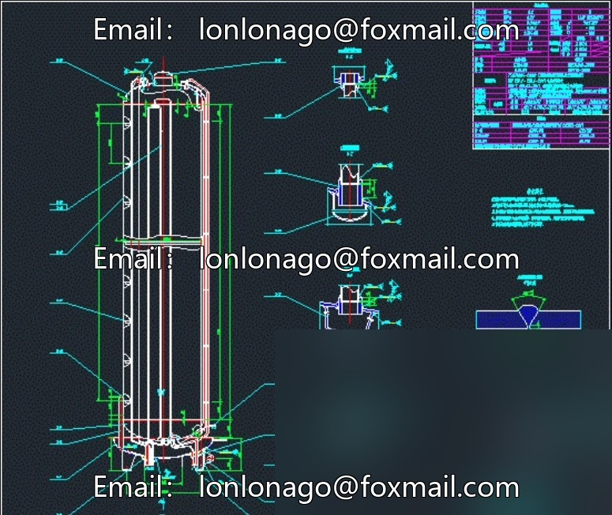
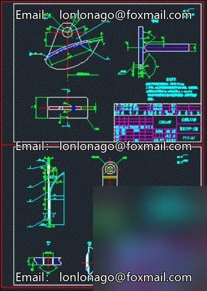

# LNG storage tank design; LNG storage tank drawing; LNG storage tank design drawing; LNG storage tank C

## Body

LNG storage tank design; LNG storage tank drawing; LNG storage tank design drawing; LNG storage tank CAD drawing; LNG storage tank design CAD drawing
430 This design introduces the basic structure of a vertical vacuum powder-insulated LNG storage tank. The external piping and operating system are placed at the bottom of the tank, and the inner cylinder is used to hold LNG, with various pipelines connected to it extending via the sandwich space to the external piping system.
This design contains only CAD drawings.

The images show LNG storage tank design CAD plans, including design parameters, working pressure, volume density, and design thickness.

<!-- AI_ENRICHED -->

## Images

## Payment

Here is a pay link on Stripe ( https://buy.stripe.com/3cs8yP7sY87d0vu9AB ). Please contact me lonlonago@foxmail.com after funding $89, and I will send you a complete data files , thank you!

